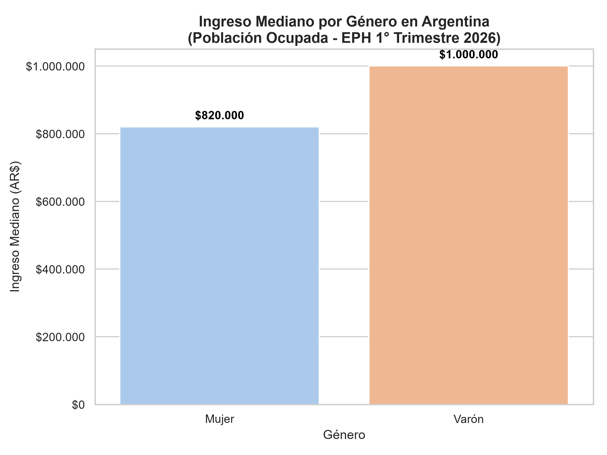
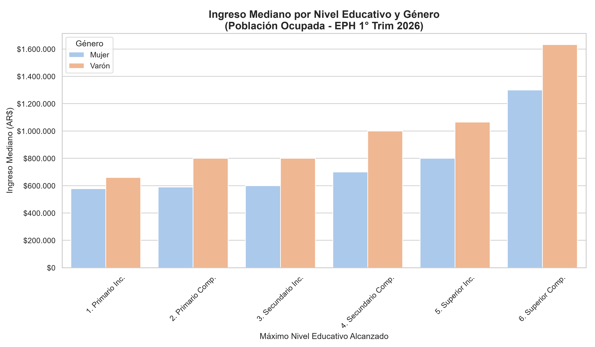
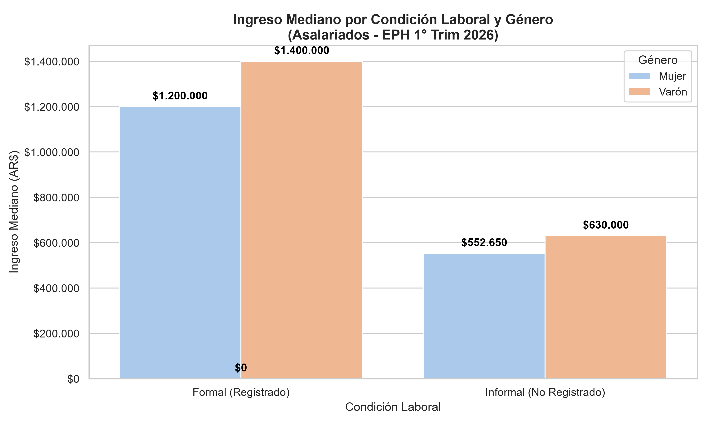

# Análisis de la Brecha de Ingresos y Precarización Laboral en Argentina

**Fuente:** Encuesta Permanente de Hogares (EPH - INDEC) | 1° Trimestre 2026.

## Objetivo del proyecto

Analizar empíricamente la estructura de ingresos de la población ocupada mediante el procesamiento de microdatos de la EPH, evaluando el impacto del género, el nivel educativo y la informalidad laboral en la brecha de ingresos.

## Herramientas utilizadas

- **Lenguaje:** Python
- **Librerías:** Pandas (limpieza y manipulación de datos), Matplotlib y Seaborn (visualización)
- **Metodología:** uso de la mediana de ingresos (reduce el efecto de valores extremos) y cruce de variables categóricas: sexo, nivel educativo y condición de registro laboral

## Hallazgos principales

**Muestra:** 15.182 personas ocupadas con ingresos válidos (de 43.739 encuestadas).

1. **Brecha general:** las mujeres ocupadas perciben un 18,0% menos que los varones, tomando la mediana del ingreso total individual ($820.000 vs. $1.000.000).
2. **La educación no cierra la brecha:** en todos los niveles educativos la mediana de las mujeres es menor. La diferencia en pesos es mayor en los niveles más altos (de $82.150 en Primario incompleto a $332.500 en Superior completo), aunque en términos porcentuales la brecha no crece: ronda el 30% en Secundario completo y baja al 20% en Superior completo.
3. **El peso de la informalidad:** entre asalariados, el trabajo no registrado reduce la mediana de ingresos más de un 50% para ambos géneros (54% en mujeres y 55% en varones). La brecha porcentual es de 14,3% entre registrados y 12,3% entre no registrados: baja levemente porque los ingresos de ambos géneros se achatan hacia abajo.





## Cómo reproducir el análisis

1. Instalá las dependencias (requiere Python 3):

```bash
pip install pandas matplotlib seaborn openpyxl
```

2. Descargá la base de microdatos **individual** del 1° trimestre 2026 desde el sitio del INDEC (sección EPH, bases de microdatos), en formato Excel, y guardala en la misma carpeta que el script con el nombre `usu_individual_T126.xlsx`.
3. Ejecutá el script:

```bash
python explorar_eph.py
```

El script imprime las tablas en consola y genera los tres gráficos en formato PNG.

## Limitaciones

- La variable de ingreso utilizada es el **ingreso total individual** (`P47T`), que incluye todas las fuentes de ingreso y no solo el salario de la ocupación principal.
- No se controla por horas trabajadas, edad ni rama de actividad, por lo que la brecha es **bruta** y no ajustada.
- No se aplicaron ponderadores muestrales de la EPH: los resultados describen la muestra analizada.
- La EPH releva aglomerados urbanos, no la totalidad del país.
- Los porcentajes de brecha se calculan sobre la mediana; las comparaciones por nivel educativo y condición de registro se hacen sobre subgrupos más pequeños, por lo que son menos estables.
